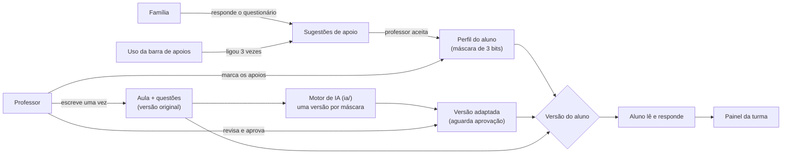
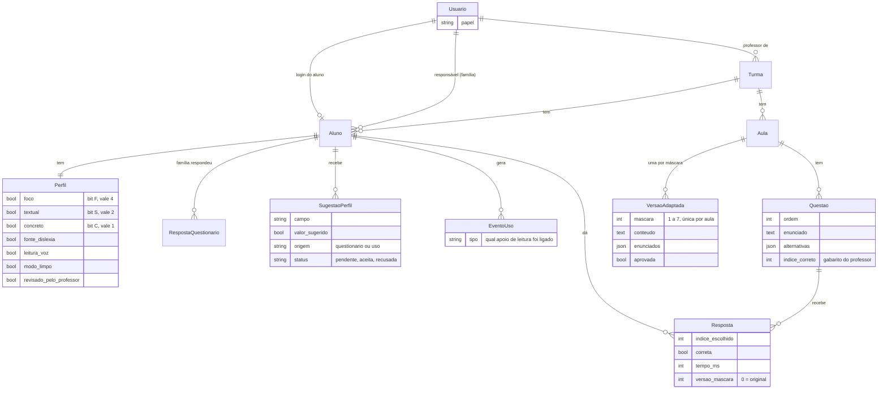
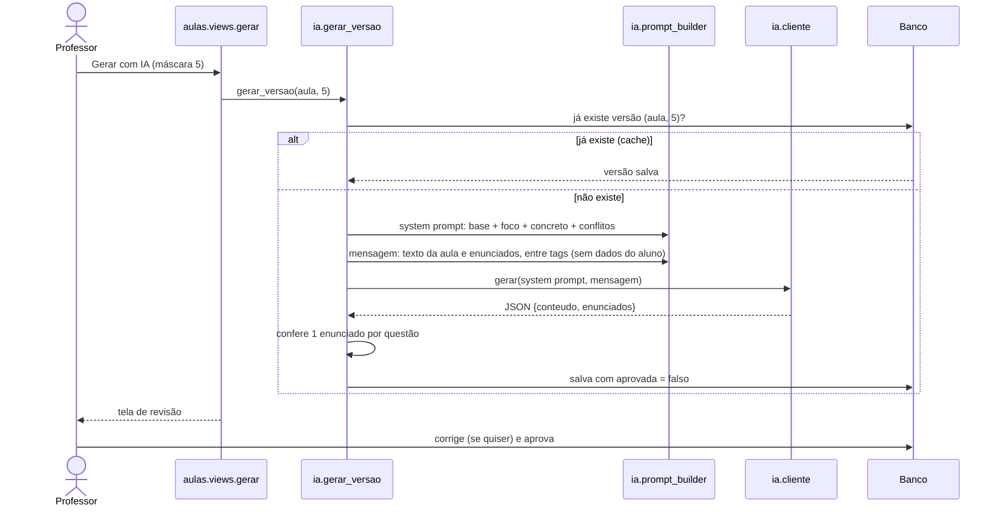

# Arquitetura do NextLearn

Um único projeto Django (Python), com páginas renderizadas no servidor. O navegador só roda JavaScript em três
pontos pequenos: a barra de apoios de leitura, a leitura em voz alta e o aviso de "gerando…".

## Visão geral

## Partes do código

| Pasta | Responsabilidade |
|---|---|
| `config/` | Configurações (tudo vem de variáveis de ambiente) e rotas principais |
| `apps/contas/` | `Usuario` com `papel` (professor, família, aluno), login, logout e o decorador `papel_requerido` |
| `apps/turmas/` | Turmas, cadastro de alunos e de famílias pelo professor |
| `apps/perfis/` | Perfil (apoios), questionário da família, sugestões de ajuste e preferências de tela |
| `apps/aulas/` | Aulas, questões, versões adaptadas, respostas, registros de uso e a tela do aluno |
| `apps/painel/` | Telas do professor com números da turma (só views e cálculos, sem tabelas próprias) |
| `ia/` | Motor de IA: blocos do prompt (`blocos/*.md`), montagem do prompt, chamada ao provedor e geração com cache |
| `templates/` | Páginas HTML (Django templates + Tailwind) |
| `static/` | CSS das preferências e os scripts da barra de apoios e da leitura em voz alta |
| `tests/` | Testes automatizados, um arquivo por fatia |

## Modelo de dados

**Máscara:** `foco×4 + textual×2 + concreto×1`, de 0 a 7. A máscara 0 é a aula original e não chama a IA, então
cada aula tem no máximo 7 versões geradas.

## Geração de uma versão adaptada

O aluno só vê a versão da sua máscara depois que ela é aprovada; até lá, vê a original. As alternativas e o gabarito
vêm sempre de `Questao`, e cada `Resposta` guarda qual versão o aluno viu, para o painel comparar acertos.

## Quem acessa o quê

- Cada tela exige login e um papel (`papel_requerido`). Tentar abrir a tela de outro papel dá erro 403.
- O professor só encontra as próprias turmas: as consultas filtram por `professor=request.user`.
- A família só responde pelos alunos de quem é responsável; o aluno só vê aulas publicadas da própria turma.
- O que vai para a IA: só os apoios ligados (bits) e o texto da aula com os enunciados. Nunca nome, login, respostas
  ou questionário do aluno.

## Testes

`python manage.py test` roda 80 testes, em `tests/`: login e papéis (Fatia 0), turma, aula e correção (1), máscara,
montagem do prompt, cache e gabarito intocado pela IA (2), preferências de tela e registro de uso (3),
questionário e sugestões (4), painel e sugestões pelo uso (5). Nos testes, a chamada à IA é simulada.
