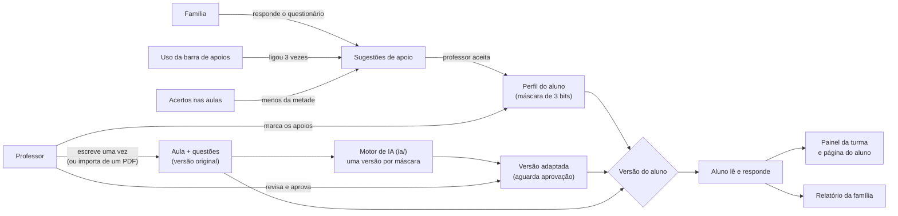
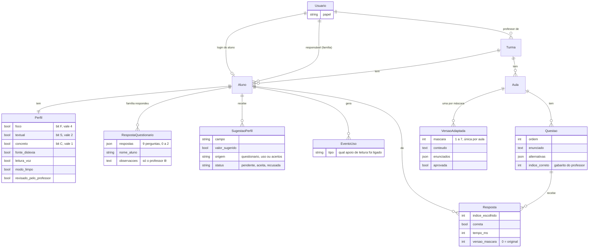
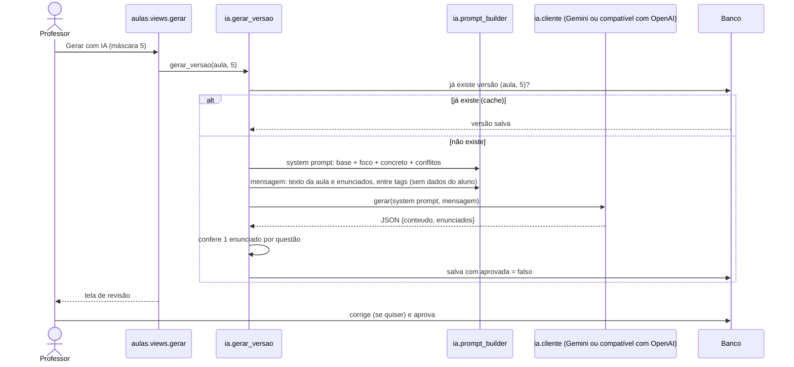

# Arquitetura do NextLearn

Um único projeto Django (Python), com páginas renderizadas no servidor. O navegador só roda JavaScript em pontos
pequenos: a barra de apoios de leitura, a leitura em voz alta, a navegação "um passo/uma questão por vez" da aula e
o aviso de "gerando…". Sem JavaScript, as páginas continuam funcionando (tudo aparece de uma vez).

## Visão geral

## Partes do código

| Pasta | Responsabilidade |
|---|---|
| `config/` | Configurações (tudo vem de variáveis de ambiente) e rotas principais |
| `apps/contas/` | `Usuario` com `papel` (professor, família, aluno), login, logout e o decorador `papel_requerido` |
| `apps/turmas/` | Turmas, cadastro de alunos e de famílias pelo professor |
| `apps/perfis/` | Perfil (apoios), questionário e relatório da família, página de cada aluno para o professor, sugestões de ajuste (pelo questionário, pelo uso em `sugestoes.py` e pelos acertos em `analise.py`) e preferências de tela |
| `apps/aulas/` | Aulas, questões, versões adaptadas, respostas, registros de uso, importação de PDF (`pdf.py`) e a tela do aluno (`versoes.py` escolhe a versão e divide o texto em passos) |
| `apps/painel/` | Telas do professor com números da turma (só views e cálculos, sem tabelas próprias) |
| `ia/` | Motor de IA: blocos do prompt (`blocos/*.md`), montagem do prompt, chamada ao provedor (Gemini ou API compatível com a da OpenAI, em `cliente.py`) e geração com cache |
| `templates/` | Páginas HTML (Django templates + Tailwind), inclusive as páginas de erro 403, 404 e 500 |
| `static/` | CSS das preferências e os scripts da barra de apoios, da leitura em voz alta e da navegação da aula (`aula.js`) |
| `tests/` | Testes automatizados (120), que também rodam no GitHub a cada envio (`.github/workflows/testes.yml`) |

## Modelo de dados

**Máscara:** `foco×4 + textual×2 + concreto×1`, de 0 a 7. A máscara 0 é a aula original e não chama a IA, então
cada aula tem no máximo 7 versões geradas.

## Geração de uma versão adaptada

O aluno só vê a versão da sua máscara depois que ela é aprovada; até lá, vê a original. As alternativas e o gabarito
vêm sempre de `Questao`, e cada `Resposta` guarda qual versão o aluno viu, para o painel comparar acertos.
Se a versão vista tem o apoio de foco, a tela divide o texto nos passos numerados que a IA escreveu e mostra um de cada vez.

Sem chave de IA configurada, a tela da aula avisa e o botão "Gerar com IA" fica desligado; o resto do app funciona.

## Quem acessa o quê

- Cada tela exige login e um papel (`papel_requerido`). Tentar abrir a tela de outro papel dá erro 403.
- O professor só encontra as próprias turmas e os próprios alunos: as consultas filtram por `professor=request.user`.
- A família só responde e só vê o relatório dos alunos de quem é responsável; o aluno só vê aulas publicadas da própria turma.
- O que vai para a IA: só os apoios ligados (bits) e o texto da aula com os enunciados. Nunca nome, login, respostas,
  questionário ou observações da família. O PDF enviado pelo professor não é guardado nem vai para a IA: só o texto
  extraído vira o rascunho da aula.

## Testes

`python manage.py test` roda 120 testes, em `tests/`:

| Arquivo | O que confere |
|---|---|
| `test_contas.py`, `test_fatia1.py` | Login e papéis (e a tela de entrar sem dicas de usuário ou senha); turma, aula e correção pelo gabarito do professor |
| `test_fatia2.py` | Máscara, montagem do prompt, cache, gabarito intocado pela IA, aprovação, aviso sem chave |
| `test_fatia3.py`, `test_fatia4.py`, `test_fatia5.py` | Preferências de tela e registro de uso; questionário e sugestões; painel e sugestões pelo uso |
| `test_privacidade_ia.py` | Observações da família e dados do aluno nunca chegam à IA; cache e aprovação preservados |
| `test_cliente_ia.py` | Escolha do provedor (Gemini ou compatível com OpenAI) e leitura do JSON |
| `test_tela_aluno.py` | Texto em passos para o apoio de foco; envio com qualquer número de questões |
| `test_pdf.py` | Nova aula a partir de PDF (texto, arquivo inválido, PDF sem texto, permissões) |
| `test_relatorio_e_acertos.py` | Relatório da família, página do aluno e sugestão pelos acertos |
| `test_paginas_de_erro.py` | Páginas 403, 404 e 500 em português |

Nos testes, a chamada à IA é simulada: não precisam de chave nem de internet.
